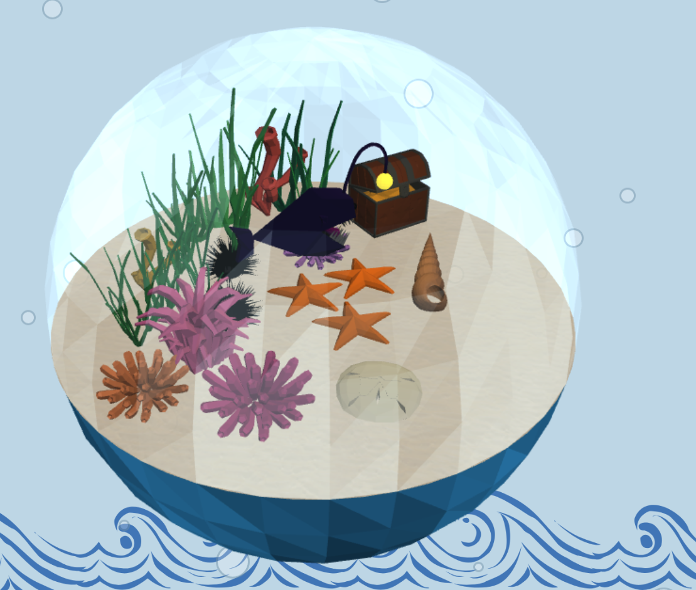
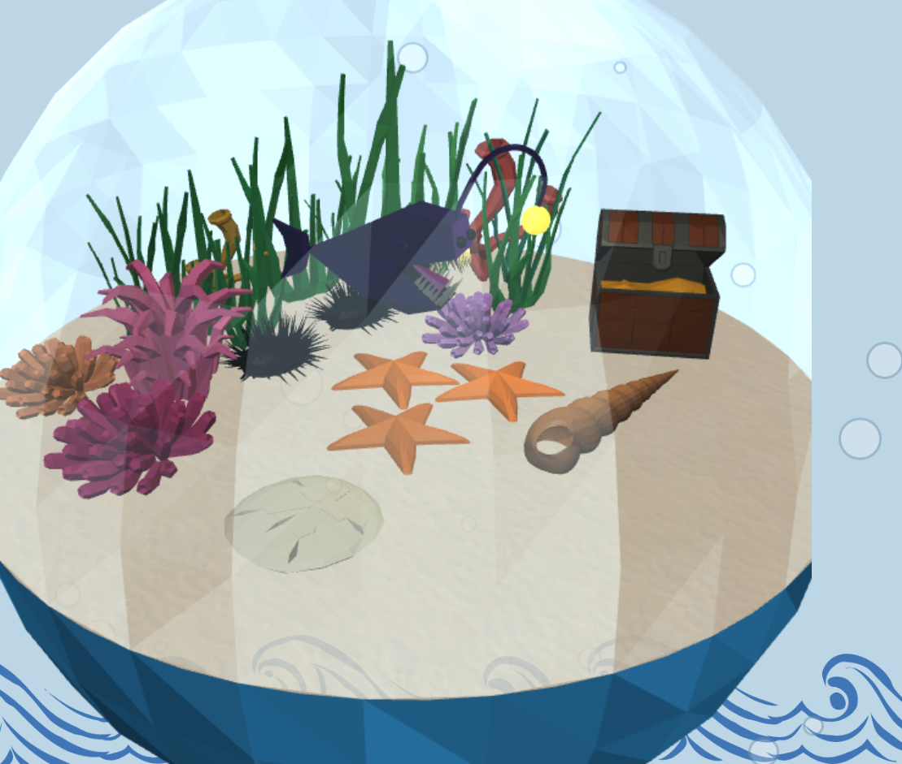
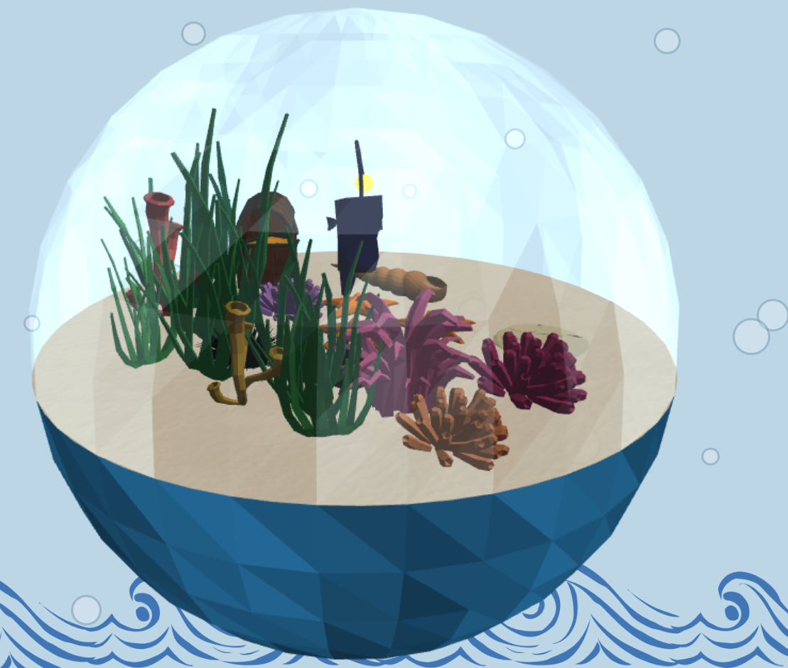

# 🐠 Paraíso Submerso

Um diorama 3D feito em **WebGL2**, onde um aquário em formato de pokébola guarda areia, vida marinha, um baú do tesouro que abre e fecha e um peixe-lanterna que ilumina o cenário ao redor.

## (a) A Cena

**Paraíso Submerso** é um diorama 3D visto de fora: um aquário fechado, com um disco de areia sobre um hemisfério azul (o "chão" da pokébola) e uma cúpula de vidro por cima. No chão vivem algas, corais, conchas, estrelas-do-mar, ouriços, uma bolacha-do-mar, uma anêmona e um baú do tesouro cuja tampa abre e fecha sozinha. O personagem é um peixe-lanterna, que muda de lugar a cada toque da tecla **P** e cuja isca amarela acende o que está perto dele.

O aquário pode ser observado de duas formas: uma câmera automática, que gira ao redor dele, e uma câmera orbital, controlada pelo mouse. A iluminação usa o modelo de **Phong** (uma luz direcional vinda de cima e a luz pontual do peixe) e pode ser ligada e desligada. Uma música de fundo completa o clima de mergulho.

O projeto foi desenvolvido com **WebGL2** e **TWGL.js**, com shaders próprios, modelos `.obj` carregados por um leitor feito para o projeto, e uma interface em HTML/CSS sobreposta à cena.

### Checklist dos obrigatórios

**Mundinho**

- [x] **Chão circular com os objetos do cenário** - disco de areia (com textura) e, sobre ele, os objetos `.obj` do cenário.
- [x] **Pelo menos 3 tipos de objetos diferentes** - são oito: concha, alga, estrela-do-mar, ouriço, bolacha-do-mar, coral, kelp e anêmona.
- [x] **Hemisfério abaixo do círculo** - hemisfério azul em estilo _low-poly_, o "chão" da pokébola.
- [x] **Objeto único desenhado de forma hierárquica** - o baú do tesouro: o **corpo** é a parte fixa e a **tampa** é a parte giratória, presa à dobradiça.

**Personagem**

- [x] **Personagem que habita o diorama** - o peixe-lanterna, um modelo `.obj` de terceiros.
- [x] **Tecla P alterna as poses (posição + orientação)** - são quatro: a posição inicial, "curioso" (perto da cúpula), "escondido nas algas" e "descansando na areia".

**Câmera**

- [x] **Projeção perspectiva**.
- [x] **Duas câmeras, alternadas pelas teclas 1 e 2**.
- [x] **Câmera 1 (automática)** - visão a 45° acima do chão, olhando para o centro do diorama e girando ao longo do tempo. O scroll do mouse aproxima ou afasta a câmera.
- [x] **Câmera 2 (orbital)** - controlada pelo movimento do mouse, com o alvo fixo no centro do diorama.

**Gráficos**

- [x] **Iluminação dinâmica (Phong)** - uma luz direcional vinda de cima (mais a luz pontual do peixe), com materiais diferentes para cada tipo de objeto.
- [x] **Tecla L liga e desliga a iluminação**.
- [x] **Texturas ou estilo _low-poly_** - textura de areia no chão; os demais objetos seguem o estilo _low-poly_ (opção prevista no enunciado), cada um com sua cor e seu material.

## (b) Criador(es)

### **Marina Stefane Candido Delfino**

marinadelfino03@gmail.com  
[github.com/marinastefane](https://github.com/marinastefane) - [linkedin.com/in/marinastefane](https://www.linkedin.com/in/marinastefane)

### **Sophia Ferreira Corrêa da Silva**

sophia.silva@aluno.cefetmg.br
[github.com/SophiaFCS93](https://github.com/SophiaFCS93)

## (c) Media Kit

  
  

## (d) Opcionais

Itens opcionais implementados neste projeto, conforme lista do enunciado:

### Relativas ao Mundo

- ⭐ **Modelos tridimensionais**: _"em vez de usar os sólidos próprios ou da TWGL.js, crie ou use modelos tridimensionais de terceiros e carregue-os no seu programa. Um formato simples é o .obj (mas ele não suporta animação). Tem também o formato glTF (mais complexo mas suporta animação)"_.
  - **Implementado:** Concha, algas, estrela-do-mar, ouriços, bolacha-do-mar, corais, anêmona, baú e o peixe-lanterna são modelos de terceiros em formato `.obj`, carregados por um leitor de OBJ próprio.

- **Vários tipos de objetos**: _"em vez de compor o cenário com apenas 03 tipos de objetos, tenha uns 07 tipos diferentes para dar variedade"_.
  - **Implementado:** Oito tipos de objetos no cenário (concha, alga, estrela-do-mar, ouriço, bolacha-do-mar, coral, kelp e anêmona), além do baú e do peixe.

### Relativas a Gráficos

- **Fontes de luz pontuais**: _"coloque fontes de luz em alguns objetos do cenário (eg, luz no poste ou uma poça de gosma radioativa)"_.
  - **Implementado:** A isca amarela do peixe-lanterna é uma luz pontual que acompanha o personagem e ilumina os objetos próximos, somada à luz direcional do aquário.

- **Material transparente**: _"tenha algo como vidro ou outra coisa que seja semitransparente. Detalhe: objetos transparentes devem ser desenhados por último. Se fizer o opcional "Líquido", aí este não conta 2x"_.
  - **Implementado:** A cúpula do aquário é um vidro semitransparente (com facetas mais ou menos opacas), desenhado por último na cena.

### Outros opcionais

- 🌟 **Música, efeitos sonoros e/ou som ambiente**: _"inclua música de fundo, sons ambiente e efeitos sonoros (este último, caso haja algum tipo de interação)"_.
  - **Implementado:** Música de fundo em loop, que pode ser ligada e desligada pela tecla **M** ou pelo botão na tela.

- **(+0) Usar a TWGL.js**: _"neste trabalho está liberado usar a biblioteca (não conta como adicional, tampouco debita)"_.
  - **Implementado:** A TWGL.js é usada para os programas de shader, os buffers, as texturas e as matrizes.

## (e) Créditos

Todos os recursos de terceiros usados neste projeto:

| Recurso | Autor | Link |
|---|---|---|
| 🐚 Concha (`TurretShell.obj`) | CyberFox 3D Studio | [Link](https://www.turbosquid.com/pt_br/3d-models/3d-model-turret-shell-2265930 ) |
| 🌿 Alga (`SeaWeed.obj`) | [Autor](https://www.cgtrader.com/designers/rkuhl?utm_source=creditutm_source=credit_item_page ) | [Link](https://www.turbosquid.com/FullPreview/2265930) |
| ⭐ Estrela-do-mar (`starfish.obj`) | Poly by Google | [Link](https://poly.pizza/m/6H-0K9IEr56) |
| ⚫ Ouriço-do-mar (`Mesh_SeaUrchin.obj`) | Poly by Google | [Link](https://poly.pizza/m/f4iwEhEP3-d) |
| 🍪 Bolacha-do-mar (`Mesh_SandDollar.obj`) | Poly by Google | [Link](https://poly.pizza/m/5Hl_QP-zQcg) |
| 🪸 Coral (`Coraal.obj`) | Kelli Ray | [Link](https://poly.pizza/m/7Cs3rTEcpcD ) |
| 🌱 Kelp (`kelp5.obj`) | M Smith Jonn | [Link](https://poly.pizza/m/5ECC8rIOZJl) |
| 🌺 Anêmona (`CHAHIN_ANEMONE.obj`) | Poly by Google | [Link](https://poly.pizza/m/1FMGb52XdD-) |
| 📦 Baú (Chest Open) | J-Toastie | [Link](https://poly.pizza/m/5yZC6q99BI) |
| 🐠 Peixe-lanterna (Angler Fish) | Anonymous | [Link](https://poly.pizza/m/85n5_RiSeSf) |
| 📚 Biblioteca TWGL.js | Gregg Tavares | [Link](https://twgljs.org) |

O baú foi separado em corpo e tampa (partes com materiais diferentes) para poder abrir e fechar. Essa separação foi feita com ajuda de uma LLM.

---

Feito com 💙 (e muitas bolhas) e muito WebGL.
